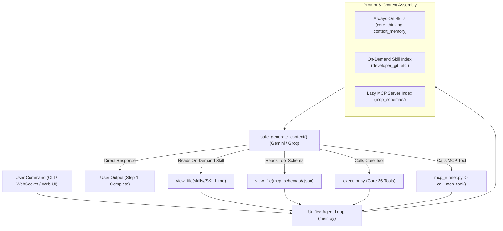

# Syntiox CORE Architecture

Syntiox CORE is an autonomous local Agentic AI operating system designed for Windows. It is built around Google's Gemini/Gemma models and Groq high-speed reasoning endpoints.

## Core Design Principles

1. **Lazy Tool Loading**: Instead of registering over a hundred function schemas into the LLM context, Syntiox CORE exposes 36 lightweight Core Tools natively and accesses 130+ specialized integrations lazily via MCP.
2. **On-Demand Domain Skills**: Specialized guidance is stored in modular `SKILL.md` files. Base reasoning and context management load automatically; domain-specific workflows (such as Git operations or document parsing) are read on-demand via `view_file`.
3. **Unified Agent Loop**: A single event-driven loop handles both simple conversational replies and complex multi-step autonomous actions without pre-routing delays.
4. **Resilient Provider Layer**: Official SDK error handling (`google.genai.errors`, `groq`, `httpx`), key rotation on quota exhaustion, and automated retry on transient backend disconnects.

## High-Level Architecture

## System Components

### 1. Unified Agent Loop (`backend/main.py`)
- Manages turn-by-turn agent execution with state streaming (`[STATE:Thinking]`, `[STATE:Planning]`, etc.).
- Evaluates tool execution results, handles user confirmations for high-risk actions, and persists run history in `history/`.

### 2. Provider Generation & Error Handling (`backend/cloud_llm.py`)
- `safe_generate_content_gemini`: Native Google GenAI SDK wrapper with automated key rotation across `GEMINI_API_KEY`s upon hitting `429 RESOURCE_EXHAUSTED`.
- `safe_generate_groq`: High-speed generation wrapper with key rotation across `GROQ_API_KEY`s.
- `safe_generate_content`: Unified dispatcher routing requests based on target model configuration.

### 3. Core Tools (`tools/core/`)
Consolidates 36 native tools into a minimal, focused footprint:
- File utilities (`view_file`, `write_to_file`, `replace_file_content`, `multi_replace_file_content`, `append_to_file`, `delete_file`, `delete_directory`, `move_file`, `find_files_by_name`, `list_dir`, `search_in_files`)
- System & terminal (`run_terminal_command`, `run_background_command`, `manage_task`, `get_system_info`, `get_current_datetime`, `schedule`, `ask_user`)
- Workspace archives (`create_zip`, `extract_zip`)
- Mouse & keyboard automation (`move_mouse`, `click_mouse`, `type_text`, `press_key`, `hotkey`, `get_mouse_position`, `take_screenshot`)
- Codebase intelligence (`index_codebase`, `semantic_search_codebase`, `grep_search`)
- Web & browsing (`search_web`, `read_url_content`, `browser_subagent`)
- Agent & sub-agents (`create_project_brain`, `spawn_subagent`, `call_mcp_tool`)

### 4. MCP Runner (`backend/mcp_runner.py`)
- Discovers and maintains tool schemas for built-in and external servers in `mcp_schemas/`.
- Executes MCP tools via `stdio_client` and passes results back to the agent loop.
